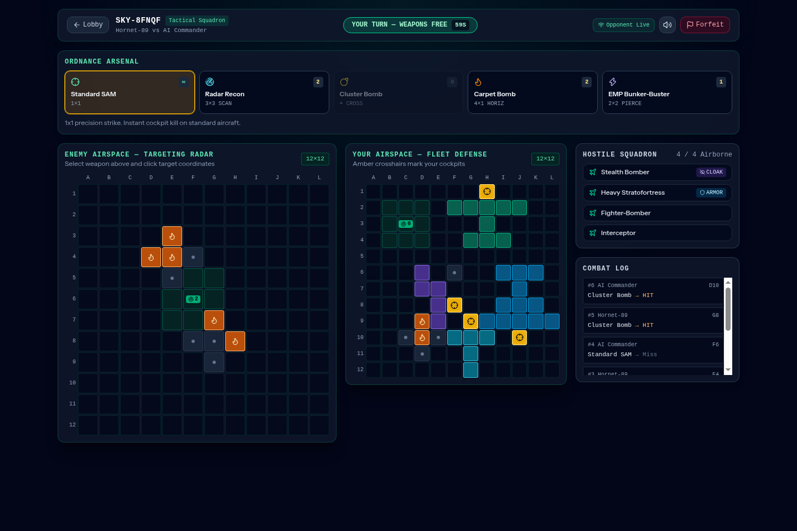
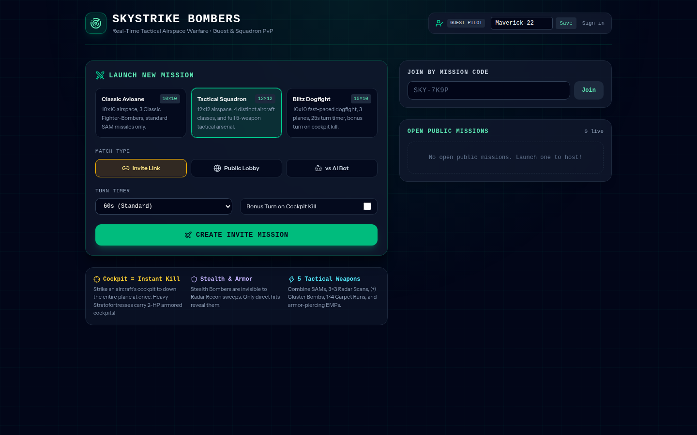

<div align="center">

# ✈️ SkyStrike Bombers

**Real-Time Multiplayer Tactical Airplanes & Bombers Game (_Avioane_ Evolved)**

_Deploy your squadron, scan enemy airspace, and launch tactical missiles in a real-time 2-player strategy game built with Laravel 13, Vue 3, Inertia v3, PostgreSQL, and Laravel Reverb WebSockets._

[](https://laravel.com)
[](https://vuejs.org)
[](https://inertiajs.com)
[](https://tailwindcss.com)
[](https://www.postgresql.org)
[](https://reverb.laravel.com)
[](https://pestphp.com)

</div>

---

## 🎯 About SkyStrike Bombers

**SkyStrike Bombers** is an open-source, real-time online multiplayer adaptation of the classic paper-and-pencil **Airplanes (_Avioane_)** grid-guessing strategy game—upgraded with **4 distinct aircraft classes**, **5 tactical weapons**, **zero-signup guest play via shareable invite links**, **live presence over WebSockets**, and a **Hunt-and-Target AI Commander** for instant solo dogfights.

Just like classic _Avioane_, hitting a wing or fuselage damages the aircraft—while striking the **Cockpit (Head)** triggers an instant catastrophic kill!

---

## 📸 Screenshots

### Live Tactical Combat Room (12×12 Squadron Mode)



### Air-Command Lobby (Guest Play, Invite Links & Public Missions)



---

## ✨ Key Features

- **⚡ Real-Time WebSockets (Laravel Reverb + Echo)** — Live presence indicators (`Opponent Live`), instant missile impact broadcasts, in-game tactical comms & quick emotes, and one-click rematches with automatic HTTP fallback if WebSockets are offline.
- **🕵️ Zero-Friction Guest Play & Invite Links** — Jump straight into a 2-player match with no registration required. Signed HTTP-only guest tokens with customizable callsigns (`Viper-42`, `Maverick-22`) allow two players on the same Wi-Fi or localhost to battle seamlessly via shareable `/games/join/{code}` invite links or the **Public Lobby**.
- **🤖 Play vs AI Commander** — Built-in Hunt-and-Target tactical AI bot that deploys randomized fleets, sweeps with Radar Recon, and targets wounded aircraft.
- **🔒 Strict Server-Side Fog of War** — Opponent coordinates are never exposed in Inertia props, JSON endpoints, or WebSocket events during active combat. Full enemy airspace is revealed only when a plane is destroyed or the match concludes.
- **🔊 Synthesized Tactical Audio** — Pure Web Audio API sound effects (radar pings, hits, cockpit kill klaxons, victory fanfare) with a mute toggle and zero external audio dependencies.
- **🐘 PostgreSQL Native Schema** — Uses `uuid` primary keys, `jsonb` columns for plane silhouettes, ordnance results, and match history, plus `lockForUpdate()` transactions to eliminate turn race conditions.

---

## 🛩️ Aircraft Classes

Every aircraft can be rotated in 4 cardinal directions (`N`, `E`, `S`, `W` via `R` or Right-Click) during fleet deployment:

| Aircraft Class           |   Size   | Cockpit HP | Tactical Passive                                                                                                        |
| :----------------------- | :------: | :--------: | :---------------------------------------------------------------------------------------------------------------------- |
| **Interceptor**          | 6 cells  |    1 HP    | Compact delta frame; grants **+1 Radar Recon** charge                                                                   |
| **Fighter-Bomber**       | 10 cells |    1 HP    | Iconic classic _Avioane_ cross silhouette; grants **+1 Cluster Bomb** charge                                            |
| **Stealth Bomber**       | 8 cells  |    1 HP    | **Radar Cloak** — completely invisible to enemy Radar Recon sweeps                                                      |
| **Heavy Stratofortress** | 13 cells |  **2 HP**  | **Reinforced Armored Cockpit** — survives 1 non-EMP cockpit hit (alerts attacker `CRACKED`) + grants **+1 Carpet Bomb** |

---

## 🚀 Tactical Ordnance Arsenal

| Weapon                |    Pattern    | Special Mechanics                                                                                                         |
| :-------------------- | :-----------: | :------------------------------------------------------------------------------------------------------------------------ |
| **Standard SAM**      |     `1×1`     | Unlimited precision strike. Instant cockpit kill on 1-HP aircraft; cracks Heavy armor.                                    |
| **Radar Recon Pulse** |     `3×3`     | Non-lethal scan returning the exact count of non-stealth aircraft cells in the zone.                                      |
| **Cluster Bomb**      | `+` (5 cells) | Cross-pattern blast ideal for finding silhouettes; cracks but cannot instant-kill cockpits.                               |
| **Carpet Bomb**       | `1×4` (H / V) | Rotatable line strike (`R` key) designed to slice across wings and fuselages.                                             |
| **EMP Bunker-Buster** |     `2×2`     | **Armor-Piercing** (one-shots Heavy Stratofortress cockpits!) and **EMP-jams** the opponent's special weapons for 1 turn. |

---

## 🎮 Game Modes

| Mode                              |  Grid   | Fleet                                        | Rules                                            |
| :-------------------------------- | :-----: | :------------------------------------------- | :----------------------------------------------- |
| **Tactical Squadron** _(Default)_ | `12×12` | 1 Heavy, 1 Stealth, 1 Fighter, 1 Interceptor | Full 5-weapon arsenal, configurable turn timer   |
| **Classic Avioane**               | `10×10` | 3× Classic Fighter-Bombers                   | Pure nostalgia — Standard SAM missiles only      |
| **Blitz Dogfight**                | `10×10` | 1 Fighter, 1 Stealth, 1 Interceptor          | Fast 25s turn timer + Bonus Turn on Cockpit Kill |

---

## 🛠️ Tech Stack & Architecture

- **Backend**: PHP 8.5, Laravel 13, Laravel Reverb (WebSockets), Laravel Fortify, Laravel Wayfinder
- **Frontend**: Vue 3 (`<script setup lang="ts">`), Inertia.js v3, Tailwind CSS v4, TypeScript, Lucide Icons
- **Database**: PostgreSQL (`uuid` + `jsonb`), Eloquent ORM with row-level `lockForUpdate()` transactions
- **Quality & Testing**: Pest 5 (Unit & Feature suites), Larastan / PHPStan, Laravel Pint, `vue-tsc`, Vite+ (`vp check`)

---

## 🚀 Quick Start (Local Development)

### Prerequisites

- PHP 8.3+ (tested on PHP 8.5) with `pdo_pgsql`
- Composer & Node.js 20+
- PostgreSQL 15+

### Installation

```bash
# 1. Clone the repository
git clone https://github.com/micos7/skystrikebombers.git
cd skystrikebombers

# 2. Install PHP & JS dependencies
composer install
npm install

# 3. Configure environment
cp .env.example .env
php artisan key:generate
```

Update your PostgreSQL & Reverb settings in `.env`:

```env
APP_NAME="SkyStrike Bombers"
APP_URL=http://localhost:8000

DB_CONNECTION=pgsql
DB_HOST=127.0.0.1
DB_PORT=5432
DB_DATABASE=bombers
DB_USERNAME=postgres
DB_PASSWORD=your_password

BROADCAST_CONNECTION=reverb
REVERB_HOST="127.0.0.1"
REVERB_PORT=8080
REVERB_SCHEME=http

VITE_REVERB_APP_KEY="${REVERB_APP_KEY}"
VITE_REVERB_HOST="localhost"
VITE_REVERB_PORT="${REVERB_PORT}"
VITE_REVERB_SCHEME="${REVERB_SCHEME}"
```

```bash
# 4. Run PostgreSQL migrations & build frontend assets
php artisan migrate
npm run build

# 5. Start Laravel & Reverb WebSocket server
php artisan serve
php artisan reverb:start
```

Open `http://localhost:8000` in two browser windows (normal + incognito) to play a live 2-player Guest PvP match via Invite Link, or select **vs AI Bot** to deploy immediately!

---

## ✅ Running Tests & Quality Checks

```bash
# Pest unit & feature tests (geometry, ordnance, fog-of-war security, PvP & AI flows)
php artisan test --compact

# Static analysis & code style
composer run types:check
vendor/bin/pint --test

# Frontend TypeScript & linter
npm run types:check
npm run check
```

---

## 📄 License

This project is open-sourced software licensed under the [MIT license](https://opensource.org/licenses/MIT).
